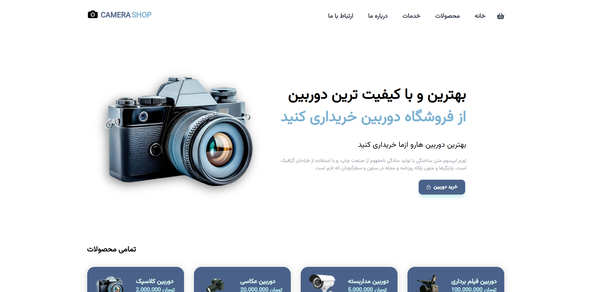

  

# 📸 Camera Shop — Frontend Design Concept

## 🚧 Project Status: Archived Experiment

Camera Shop is a personal frontend practice project created while I was learning and working with React.

The project explores the design of a modern camera store interface, with a focus on visual presentation, smooth animations, and interactive UI elements.

This is a **design concept and learning project**, not a real online store. It represents an earlier stage of my frontend development journey and my experience building interfaces with React.

---

## ✨ Project Goals

- 🎨 Experimenting with modern e-commerce UI design
- ⚛️ Practicing React component-based development
- 🎬 Creating smooth and engaging interface animations
- 📱 Exploring responsive frontend layouts
- 🚀 Improving frontend development and UI design skills

---

## 🛠️ Tech Stack

  
  

### 🎬 Animation Library

- **Framer Motion** — Smooth transitions and interactive UI animations

---

## 📸 Preview

A visual concept of a camera store interface, built as part of my frontend learning journey.

---

## 👨‍💻 Author

**Arsham Ghaderi**

Frontend Developer

[GitHub Profile](https://github.com/Arsham-369-Ghaderi)

---

⭐ This project reflects an earlier stage of my journey in frontend development and my experiments with React and modern UI design.
